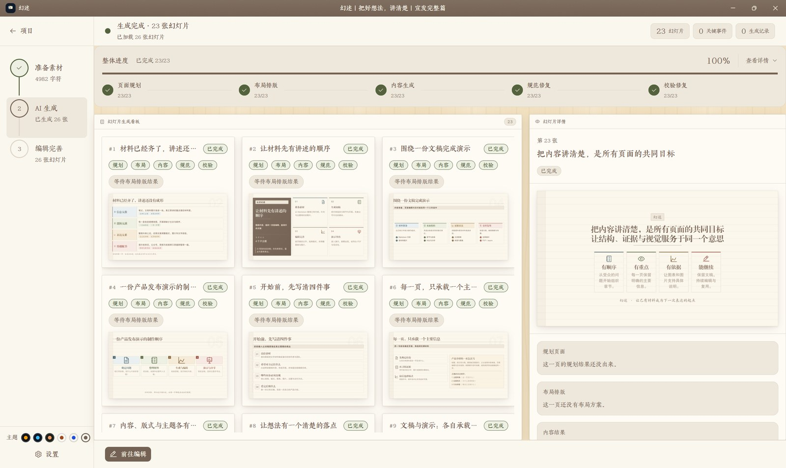
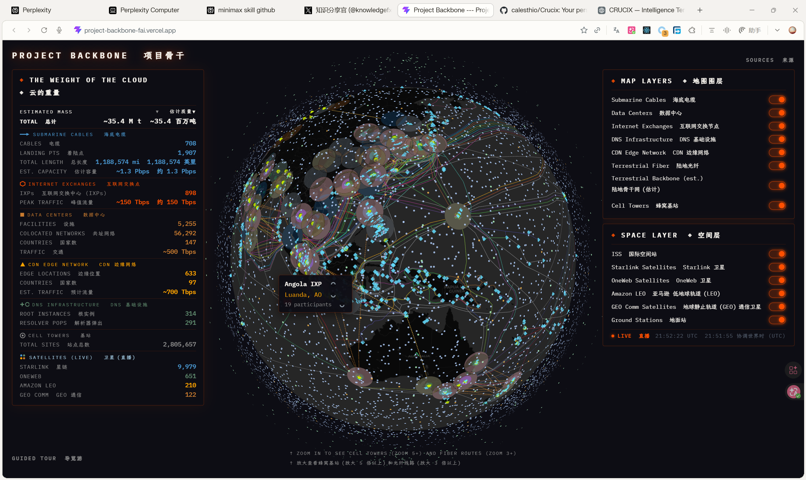
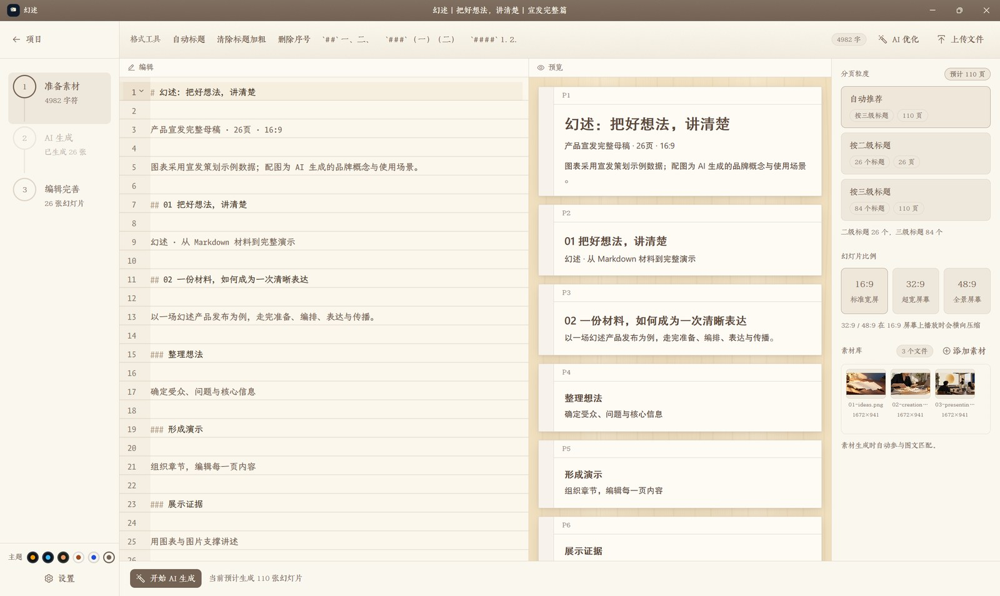
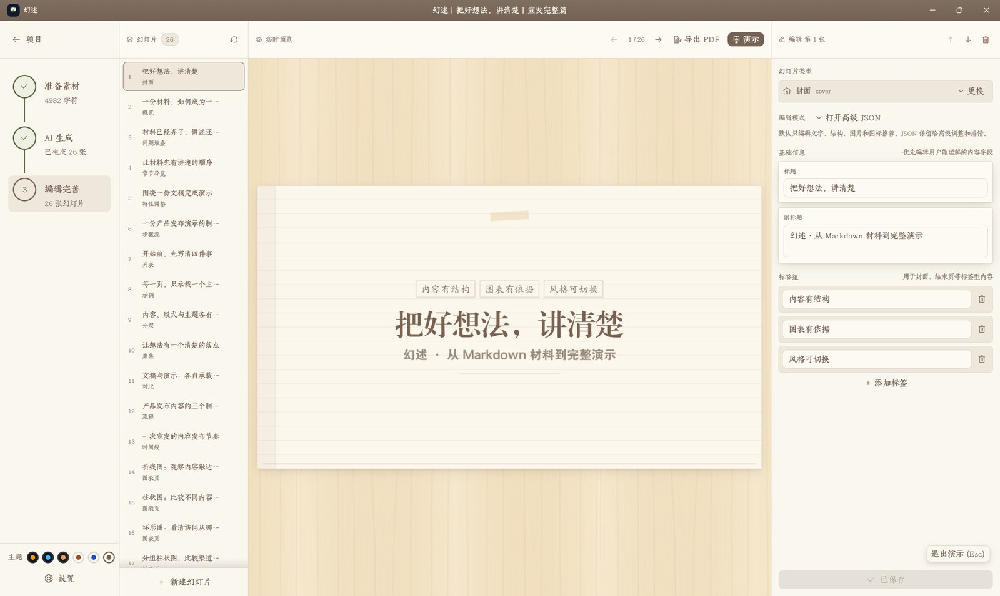
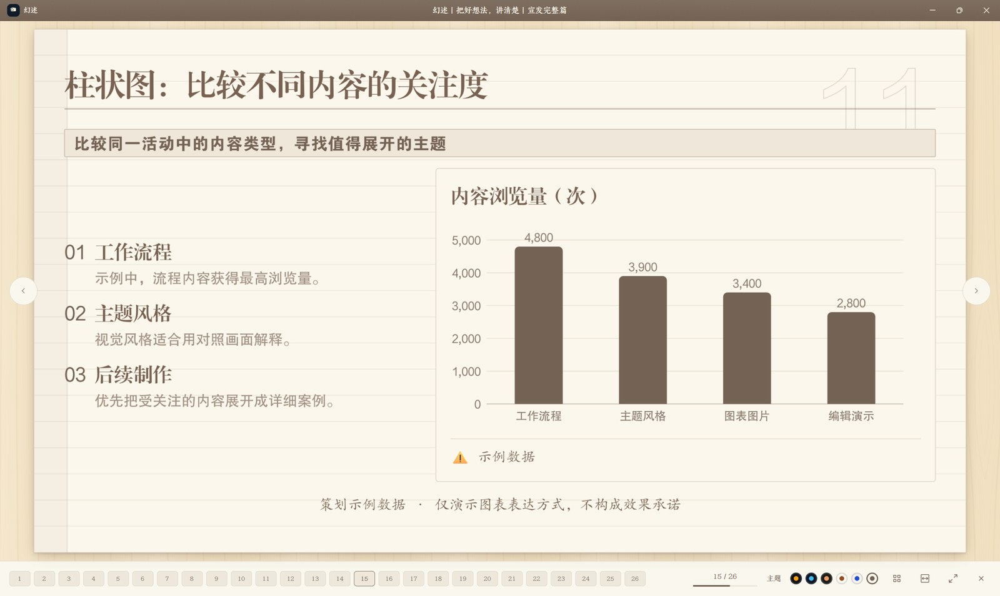
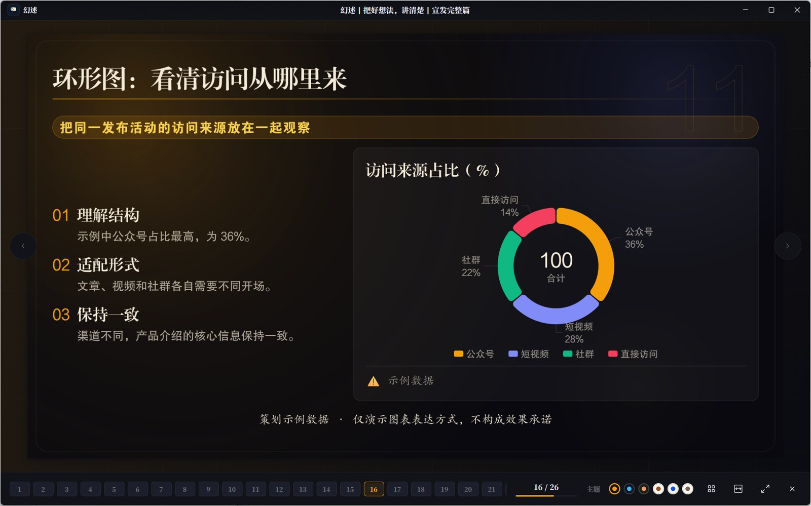
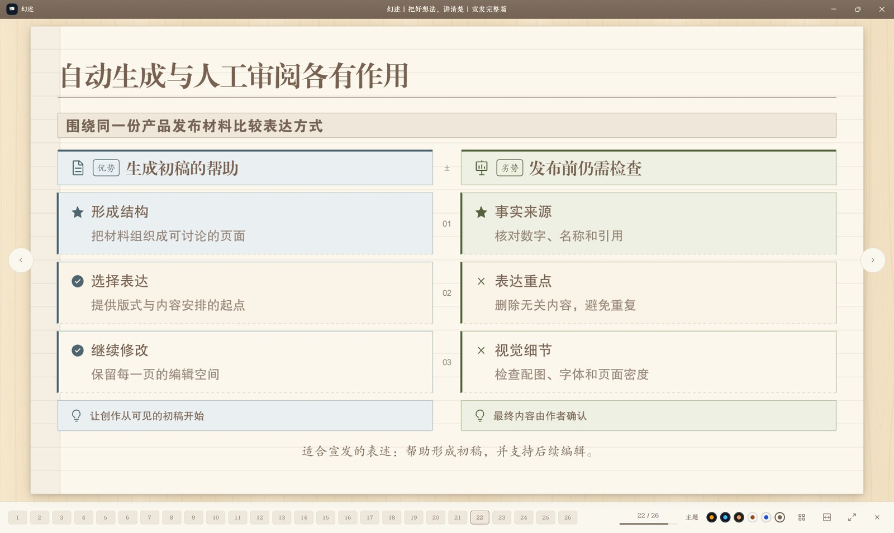
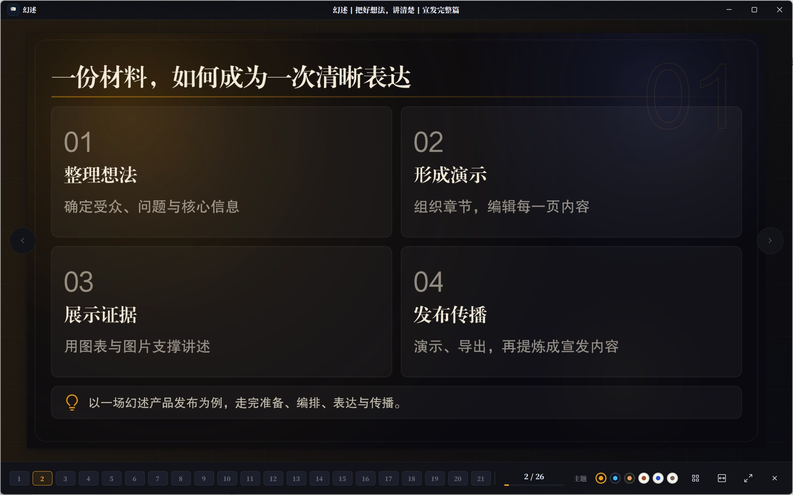
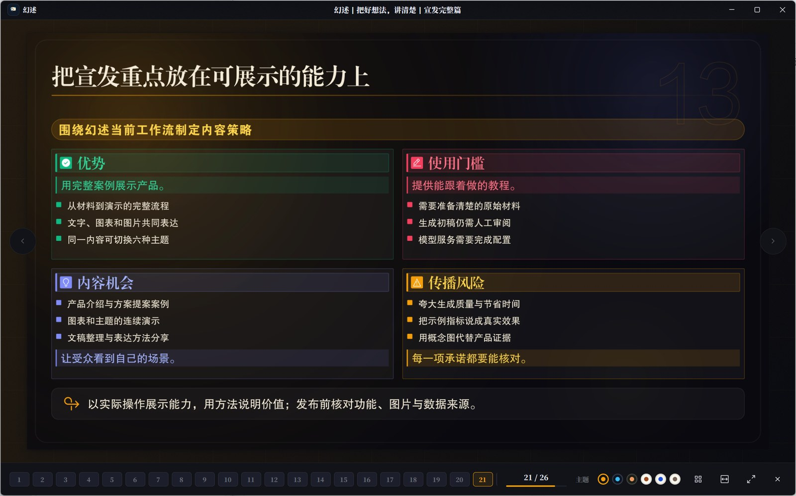

# 幻述 - AI 演示文稿生成工作室

[](https://github.com/billowsand/huanshu/actions)
[](LICENSE)
[](https://www.rust-lang.org)
[](https://vuejs.org)
[](https://typst.app)
[](https://github.com/zed-industries/zed)

> 把一份 Markdown 材料变成一套可以直接讲的演示文稿 —— AI 选版式，Typst 负责排版，完全本地运行



<sub>第二步「AI 生成」：每页独立状态与进度，右侧是这一页的蓝图、校验与重试</sub>



## 30 秒上手

仓库里有两套界面，共用同一份业务内核 `huanshu-core`：Tauri + Vue 版与原生 GPUI 版。

```bash
# Tauri + Vue 版
bun install
bunx tauri dev

# 原生 GPUI 版（不需要 bun，直接 cargo 跑）
cargo run -p huanshu-native --release
```

打开应用后，先在「设置」里填写 LM Studio 的模型名称
（LM Studio 需要在 Local Server 界面启动，加载聊天模型 + Embedding 模型）。

> 首次运行不想接模型，可以在沙箱目录里灌一批演示项目：
> `$env:HUANSHU_HOME = 'E:\huanshu\target\sandbox-home'` 后执行
> `cargo run -p huanshu-core --example seed_demo -- $env:HUANSHU_HOME`。

## 功能特点

- **三步生成**：素材准备 → AI 生成 → 编辑完善
- **智能布局**：AI 为每页给出 2–3 个版式候选，再由全局分配器均衡整副牌组（18 种版式）
- **多比例支持**：16:9 标准、32:9 超宽、48:9 全景
- **并发生成**：多页并行处理，实时跟踪每页状态；单页可单独重试
- **本地运行**：基于 LM Studio 或任意 OpenAI 兼容服务（可走 SOCKS5 代理），完全离线可用
- **实时预览**：生成过程实时展示，进度一目了然
- **一个渲染器**：屏幕上的幻灯片、编辑器预览和 PDF 都是同一份 Typst 排版结果，屏幕上看到的就是导出的
- **原生 PDF 导出**：内嵌 Typst 直接把蓝图排版成矢量 PDF（18 种模板 × 6 套主题），不需要浏览器或外部 CLI；导出结果会列出占位页、被裁切的页与缺失的图片
- **原生界面**：Rust / GPUI 重写的界面（`apps/huanshu-native`），逐页复刻功能并用上 GPUI 组件，与 Tauri 版共用数据目录
- **主题与图表**：6 套主题（便签·稿纸、终端·纸、终端·墨、报刊·钴蓝、暗·琥珀、暗·星图）；`chart` 围栏块生成数据图表页（折线 / 柱状 / 环形 / 分组柱状 / 堆叠面积），`$...$` / `$$...$$` 数学公式同样由 Typst 排版
- **图文配对**：素材库图片连同文稿大纲交给多模态模型，判断每张图该放在哪一页、起什么作用
- **加密导出**：AES-256-GCM 加密的项目文件导出与导入

## 界面截图

三步工作流（原生 GPUI 版）：

<table>
<tr>
<td align="center" width="33%"><br><sub>第一步 · 准备素材：Markdown、生成粒度、比例、素材库</sub></td>
<td align="center" width="33%"><br><sub>第二步 · AI 生成：逐页进度、蓝图校验、单页重试</sub></td>
<td align="center" width="33%"><br><sub>第三步 · 编辑完善：版式表单 + Typst 实时预览 + 导出 PDF</sub></td>
</tr>
</table>

演示模式：同一副牌组，左列是「便签·稿纸」，右列是「暗·琥珀」（截图取自同一份 26 页的演示文稿）：

<table>
<tr>
<td align="center" width="50%"><br><sub>便签·稿纸 · 封面</sub></td>
<td align="center" width="50%"><br><sub>暗·琥珀 · 封面</sub></td>
</tr>
<tr>
<td align="center"><br><sub>便签·稿纸 · 数据图表页（右侧柱状图，左侧解读）</sub></td>
<td align="center"><br><sub>暗·琥珀 · 数据图表页（环形图）</sub></td>
</tr>
<tr>
<td align="center"><br><sub>便签·稿纸 · 双栏对比</sub></td>
<td align="center"><br><sub>暗·琥珀 · 特性网格</sub></td>
</tr>
<tr>
<td align="center"><br><sub>便签·稿纸 · 焦点页（图片铺排）</sub></td>
<td align="center"><br><sub>暗·琥珀 · 四象限要点页</sub></td>
</tr>
</table>

> 截图里的演示文稿由幻述自己生成（《把好想法，讲清楚》，26 页），用的就是本仓库的版本。

## 环境要求

| 工具 | 版本 | 说明 |
|------|------|------|
| [LM Studio](https://lmstudio.ai/) | 任意 | 需加载聊天模型和 Embedding 模型 |
| Node.js | 18+ | 前端构建 |
| Rust | 1.77+ | 后端编译 |
| Bun | 1.0+ | 包管理器 |

## 安装运行

想直接用：到 [Releases](https://github.com/billowsand/huanshu/releases) 下载安装包（Windows / Linux）。
原生 GPUI 版也可以在本机出包：

```powershell
# 原生界面（免安装单文件 + NSIS 安装包 → dist-package/）
powershell -NoProfile -ExecutionPolicy Bypass -File scripts/package-native.ps1
```

从源码运行：

```bash
# Tauri + Vue 版：开发模式（推荐）
bunx tauri dev

# 生产构建（自动先跑前端 `bun run build`，产物 targets 见 src-tauri/tauri.conf.json）
bunx tauri build --bundles nsis
# 安装包：target/release/bundle/nsis/Huanshu_<version>_x64-setup.exe
# 免安装单文件：target/release/auto-slidev-studio.exe

# 原生 GPUI 版
cargo run -p huanshu-native --release
```

> ⚠️ **不要用 `cargo build --release` 或 `cargo tauri build`** 去构建 Tauri 版。缺少 `custom-protocol` feature 时
> Tauri 会把二进制约成 dev 模式（前端资源不内嵌，运行时去连 `localhost:5173`），
> 双击只会看到 `ERR_CONNECTION_REFUSED`。详见 [SETUP.md](SETUP.md)。

## 使用步骤

### 第一步：准备素材

1. 输入项目名称
2. 粘贴或上传 Markdown 内容
3. 选择生成粒度：**H2**（每个 `##` 一页）或 **H3**（每个 `###` 一页）
4. 选择幻灯片比例：16:9 / 32:9 / 48:9
5. 可选上传配图
6. 点击 **开始生成**

### 第二步：AI 生成

等待生成完成，实时查看：
- 当前阶段（初始化、页面规划、布局规划、内容生成、修复验证）
- 每页的独立生成状态与进度
- 每个阶段的具体日志
- 点击日志可查看详细 Prompt 和输出

### 第三步：编辑完善

1. 左侧是全部幻灯片，右侧是当前页的实时预览（Typst 排版，改字即刻更新）
2. 中间的表单按版式给出字段：标题、副标题、要点、图表 JSON、素材引用……
3. 版式不合适就换版式，改动当场重排
4. 单页没生成好，可以回到第二步单独重试
5. 满意后进入演示模式，或导出 PDF / `.keynn`

## 幻灯片生成机理

### 整体流程

```
Markdown 文档
     │
     ▼
┌─────────────────┐
│  解析文档        │  input.rs
│  parse_markdown │  title / intro / sections / subsections / chart 围栏块
└────────┬────────┘
         │
         ▼
┌─────────────────┐
│  分页 + 配图     │  planning::derive_page_plans   按标题层级分页（不调 LLM）
│  page plans     │  media_match                   多模态模型：每张素材图该放哪一页
└────────┬────────┘
         │
         ▼
┌─────────────────┐
│  2a 并发规划     │  slides::plan_single_page
│  候选版式        │  每页按 content_shape / argument_mode /
│                 │  density / visual_need 打分，给 2–3 个候选
└────────┬────────┘
         │
         ▼
┌─────────────────┐
│  2b 全局分配     │  planning::assign_layouts（纯 CPU、确定性）
│  版式分配        │  最大化 Σscore − 3·相邻同款 − 1·隔页同款
│                 │  − 2·单一版式超出 30% 上限
└────────┬────────┘
         │
         ▼
┌─────────────────┐
│  2c 并发生成     │  generate_single_page_pipeline
│  内容生成        │  content → normalize → validate
│                 │  失败带反馈重写，最多 3 轮 + 兜底版式
└────────┬────────┘
         │
         ▼
┌─────────────────┐
│  装配输出        │  assemble_slides：追加封面 / 目录 / 结尾
└────────┬────────┘
         │
         ▼
   Typst 渲染：缩略图 / 编辑器预览 / 演示 / PDF 导出
```

### 图表数据（```chart 围栏块）

Markdown 正文中可以用 ` ```chart ` 围栏块直接携带图表数据，归属其所在的 H2/H3 小节。
正文较短时，小节的第一张图与文字同页，生成 `chart_focus` 版式（左侧要点解读 + 右侧图表）；正文较长（约 300 字以上）时拆成两页，
文字页照常选版式，图表紧跟着单独成页。多出的图各追加一页。

````markdown
## 经营回顾

### 交付情况

业务逐季提速，Q3 起增速明显加快。

```chart
{
  "type": "bar",                        // line | bar | donut | grouped_bar | stacked_area
  "title": "季度交付量",
  "data": [
    { "quarter": "Q1", "count": 12 },
    { "quarter": "Q2", "count": 19 },
    { "quarter": "Q3", "count": 27 }
  ],
  "encoding": { "x": "quarter", "y": "count" },
  "source": "user_input"                // 决定来源角标：llm_generated 显示「⚠ 示例数据」
}
```
````

多系列图（`grouped_bar` / `stacked_area`）额外需要 `series: [{ "key": "列名", "name": "图例名" }]`，
`donut` 用 `encoding.label` / `encoding.value` 指认分类与数值列。

图表渲染只有一份实现：`crates/slide-typst/typst/lib/chart.typ` 用 Typst 原生绘制，
缩略图、演示、编辑器预览和 PDF 导出走的是同一段代码，不再经过浏览器图表库。
配色来自每套主题的 `chart` 字典（`palette` 六色、网格线、坐标轴），换主题自动跟随；
画不出来的数据（类型未知、缺列、非数字）显示占位和原因，不会让整份导出失败。

图表数据由代码从 Markdown 原样挂到页面上，模型只负责写解读文字——数据错了用户一眼能看出来，
也不会在反复重写的过程中被模型改掉。

### 数学公式

正文里的 `$...$`（行内）与 `$$...$$`（块级）会被识别：幻灯片与 PDF 里由 Typst 排版
（PDF 侧经 mitex 转换后在同一次排版中求值），原生界面第一步的预览也是 Typst 出图；
写不出正确公式时回退成原文，不会让整份导出失败。

### 核心数据结构

**PagePlan** - 页面规划单元
```json
{
  "page_id": "p1",
  "section_title": "背景介绍",
  "subsection_title": "市场现状",
  "page_title": "市场规模",
  "objective": "让观众了解市场规模",
  "key_points": ["全球市场 5000 亿", "年增长率 15%"],
  "content_shape": "overview|summary|comparison|architecture|timeline|workflow|matrix",
  "layout_intent": "左图右文",
  "visual_need": "text_only|image_optional|image_required",
  "object_count": "single|pair|multi",
  "argument_mode": "parallel|sequential|layered|summary|evidence|causal|warning",
  "density": "low|medium|high",
  "preferred_assets": ["图表", "数据"],
  "page_role": "content|section_summary"
}
```

**SlideBlueprint** - 幻灯片蓝图
```json
{
  "id": "uuid",
  "kind": "FeatureGrid",
  "aspect_ratio": "ratio_16x9",
  "cards": [...],
  "panels": [...],
  "layers": [...],
  "timeline_events": [...],
  "steps": [...],
  "compare_data": {...},
  "swot_data": {...},
}
```

### 18 种幻灯片模板

| 模板 | 用途 | 关键字段 |
|------|------|---------|
| `Cover` | 封面 | badges, title, subtitle |
| `Closing` | 结尾 | badges, title, subtitle, note |
| `Overview` | 目录 | items |
| `SectionIntro` | 章节预览 | cards |
| `FeatureGrid` | 特性网格 | cards (3+ 项) |
| `Spotlight` | 焦点展示 | image, panels, label |
| `SplitLayers` | 分层架构 | left_items, layers |
| `SectionList` | 有序列表 | list_items |
| `FocusExample` | 论点+案例 | points, example_title, example_body |
| `OutcomeGrid` | 成果展示 | cards |
| `CenterGrid` | 中心网格 | center_items, badge |
| `Timeline` | 时间线 | timeline_events |
| `StepFlow` | 步骤流 | steps |
| `Process` | 多阶段流程 | phases |
| `Compare` | 双栏对比 | compare_data |
| `IssueStack` | 问题堆叠 | cards, panels |
| `Swot` | SWOT 分析 | swot_data |
| `ChartFocus` | 数据图表解读 | points, chart |

（表里是 Rust 的枚举名；落到 JSON 与数据库里是 snake_case：`cover`、`chart_focus`……
旧数据里出现的未知版式会降级为封面而不是整副牌组反序列化失败。）

### 布局选择策略

分两步，先每页独立判断，再整副牌组一起权衡：

**第一步，逐页打候选。** 模型根据 PagePlan 的这些信号给本页排版式候选（2–3 个，带分数）：

1. **content_shape**：内容形态（概览/总结/对比/架构/时间线/流程/矩阵）
2. **object_count**：对象数量（单/双/多）
3. **argument_mode**：论证模式（并行/顺序/分层/总结/证据/因果/警示）
4. **density**：信息密度（低/中/高）
5. **visual_need**：视觉需求（纯文本/可选图/需配图）

候选随后过一遍适用条件表：内容放不下的版式（例如超宽比例下的双栏、单图版式）会被剔除；
带图表的页固定用 `chart_focus`，章节小结页固定用 `section_intro`——这两种情况不交给模型决定。

**第二步，整副牌组一起分配。** `planning::assign_layouts` 在候选集合上求最优组合，
目标函数是「总分 − 相邻同款惩罚 − 隔页同款惩罚 − 单一版式超出 30% 上限的惩罚」。
这一步不调模型，纯 CPU、确定性：同样的候选集合必然得到同样的牌组，也就不会出现「翻两页回到同一个版式」。

模型没给出可用候选时（或者修复到最后一轮仍然失败），走的是同一张版式打分表兜底，
按页面信号给所有内容版式排名，再过滤掉不适用的那些。

## 多比例幻灯片

支持三种幻灯片比例，适应不同展示场景：

| 比例 | 分辨率 | 适用场景 |
|------|--------|---------|
| 16:9 | 1280×720 | 标准屏幕、投影仪 |
| 32:9 | 2560×720 | 超宽显示器、双屏拼接 |
| 48:9 | 3840×720 | 全景展示、LED 长屏 |

- 生成时 LLM 会根据比例自动调整布局（如 FeatureGrid 使用更多列）
- 播放时幻灯片拉伸至全屏，确保在对应屏幕上完美呈现

## 加密导出 / 导入

支持将项目导出为加密的 `.keynn` 文件：

- **加密算法**：AES-256-GCM
- **密钥派生**：Argon2id
- **密码要求**：至少 8 字符，包含大小写字母和数字
- 导入时自动检测文件是否加密，加密文件需输入密码解锁

## 项目结构

业务逻辑全在 `crates/huanshu-core`（不依赖任何界面框架），两套界面都只做转发：

```
huanshu/
├── crates/
│   ├── huanshu-core/             # 业务内核：生成、存储、导出、设置（无界面依赖）
│   │   └── src/
│   │       ├── generator/        # 生成器
│   │       │   ├── planning.rs     #   分页、版式候选、全局分配
│   │       │   ├── slides.rs       #   逐页候选与内容生成流水线
│   │       │   ├── layout_rules.rs #   版式适用条件表（唯一的模板白名单来源）
│   │       │   ├── layout_scoring.rs #  LLM 失败时的确定性兜底打分
│   │       │   ├── media_match.rs  #   图文配对（多模态）
│   │       │   └── normalize.rs    #   规范化、默认值修复
│   │       ├── services/         # services::generation / projects / storage / export …
│   │       ├── editor_schema.rs  # 编辑器版式表与表单定义（前端读它）
│   │       ├── chart_check.rs    # 图表数据校验（单一实现）
│   │       ├── preview.rs        # 缩略图调度与像素渲染
│   │       ├── db.rs             # SQLite
│   │       ├── crypto.rs         # AES-256-GCM + Argon2id
│   │       ├── input.rs          # Markdown 解析
│   │       ├── lmstudio.rs       # OpenAI 兼容模型服务
│   │       └── types.rs          # 类型定义与 18 种版式
│   └── slide-typst/              # Typst 渲染器（进程内嵌编译器）
│       ├── src/                  #   lib.rs / assets.rs / icons.rs / math.rs
│       └── typst/                #   main.typ、lib/{base,components,chart}.typ
│           ├── layouts/          #     18 个版式，一个文件一个
│           └── themes/           #     6 套主题 token 与页面背景
├── apps/
│   └── huanshu-native/           # 原生界面（Rust + GPUI Kit）
│       └── src/                  #   shell / router / theme / pages
├── src/                          # Tauri 版界面（Vue 3 + Pinia）
│   ├── views/                    #   HomeView / WorkflowView / PresentationOverlay …
│   ├── stores/                   #   generation / projects / appSettings
│   └── themes/                   #   主题 token 与幻灯片外壳样式
├── src-tauri/                    # Tauri 命令外壳（只做「取参数 → 调 core → 转错误」）
├── docs/                         # 设计文档、原生界面对照表、截图
└── scripts/                      # 打包脚本（Tauri 版 / 原生版）
```

## 配置说明

### 生成设置

| 参数 | 说明 | 默认值 |
|------|------|--------|
| `concurrency` | 并行生成数量 | 3 |
| `repair_rounds` | 修复轮次 | 3 |
| `granularity` | H2 或 H3 | H2 |
| `aspect_ratio` | 16:9 / 32:9 / 48:9 | 16:9 |

### LM Studio 设置

| 参数 | 说明 | 默认值 |
|------|------|--------|
| base_url | API 地址 | http://localhost:1234 |
| chat_model | 聊天模型名称 | - |
| embedding_model | Embedding 模型 | - |
| api_key | API 密钥（可选） | - |

### SOCKS5 代理

在「设置 → 模型服务配置」中，每个服务（大语言模型、向量模型、多模态模型）均可独立启用 SOCKS5 代理：

- 代理地址填写 `socks5://127.0.0.1:1080`，也支持 `socks5h://` 和 IPv6 地址；必须填写端口。
- 需要认证时同时填写代理用户名和密码，无需认证则两项留空。
- 点击「获取模型」可测试尚未保存的代理配置；保存后应用于文稿优化、幻灯片生成与修复、向量检索和图片理解。
- 启用后，HTTP/HTTPS 模型请求通过 SOCKS5 隧道传输，模型域名由代理解析，HTTPS 仍验证服务端证书。代理失败时返回错误，不回退直连。
- 默认关闭，关闭时直接连接；本地模型与云端模型可以分别选择连接方式。云端服务需提供应用所使用的 OpenAI 兼容 API。
- 配置随模型设置保存到数据目录的 `settings.json`；代理密码与 API Key 一样保存在此文件中。

## 局限性 / 已知问题

- **模型 API 兼容性**：支持本地或云端 OpenAI 兼容服务，尚未适配其他提供商的原生 API；SOCKS5 代理只负责网络传输。
- **仅支持 Markdown 输入**：暂不支持 Word、PDF 等格式直接导入
- **中英文标题优化**：模板布局对中英文混排的优化有限
- **Embedding 模型必需**：图标语义匹配依赖 Embedding 模型，不加载会导致图标匹配失效

## 项目状态

🚧 **Beta** — 功能已基本完整，但仍在积极开发中，可能存在 breaking change。

两套界面（Tauri + Vue、原生 GPUI）共用同一个内核和同一份数据目录，功能基本对齐；
原生界面对照表见 [`docs/native/parity.md`](docs/native/parity.md)。

路线图：
- [x] 云端 OpenAI 兼容服务（可走 SOCKS5 代理）
- [ ] 原生界面完全取代 Tauri 版，Tauri 版进入维护状态
- [ ] 支持更多输入格式（Word、PDF）
- [ ] 更多幻灯片模板
- [ ] 插件系统

## License

[MIT](LICENSE)
